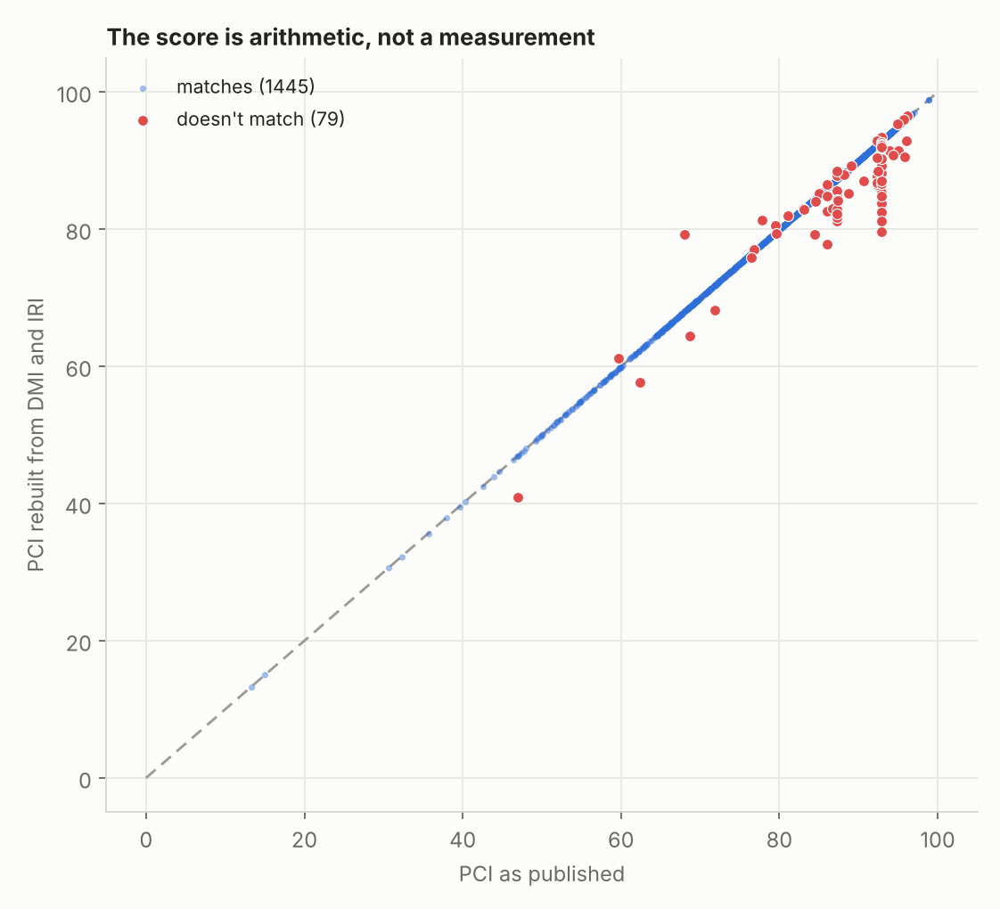
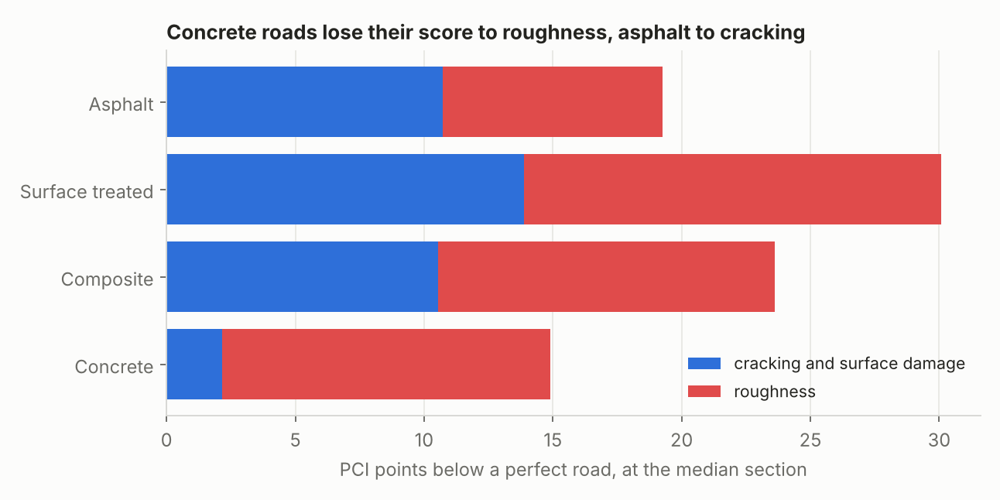
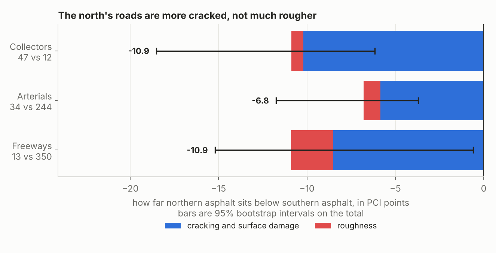
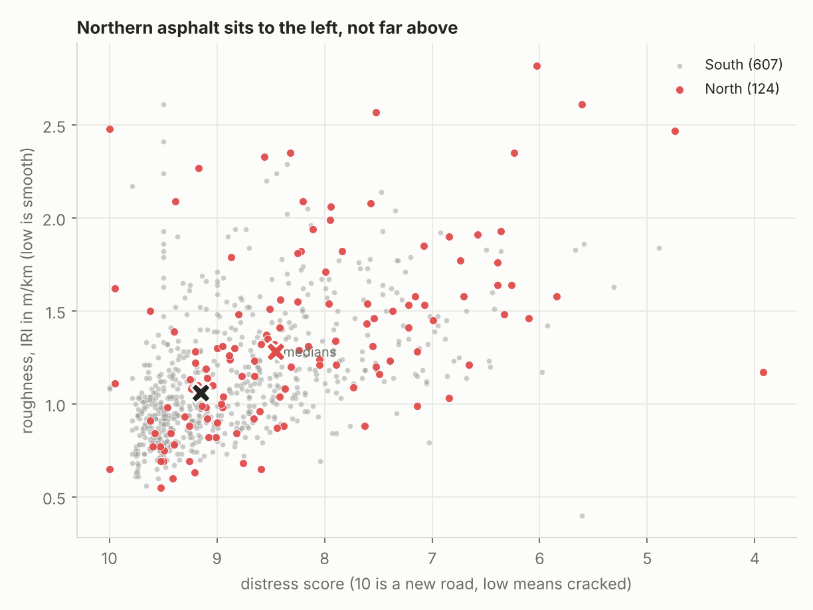

# Ontario reports one number for a road. It hides which problem you have.

Every provincial highway in Ontario gets a Pavement Condition Index, and that
one number decides where the repair money goes. I pulled the score apart into
the two things it is actually made of, for all 1,861 sections in the 2023 file.

> A road scoring 60 because it is cracked and a road scoring 60 because it is
> rough need different repairs and different budgets. PCI cannot tell them
> apart. Split it, and northern asphalt turns out to sit 7 to 11 points below
> southern asphalt, and at least three quarters of that gap is cracking rather
> than ride quality.



## Why I did this

I started out expecting the opposite. Frost heave lifts and drops a road as
the ground freezes and thaws, which wrecks ride quality, so I assumed northern
roads would be rough. They are a little rougher. Mostly they are cracked.

## The score is two numbers wearing a hat

PCI is not measured. Ontario calculates it from a distress score and a
roughness reading:

```
asphalt:   PCI = 13.75 + 9.00 x DMI - 7.50 x IRI
composite: PCI = 20.50 + 8.50 x DMI - 11.00 x IRI
```

DMI is the distress manifestation index, which runs 0 to 10 and covers
cracking, ravelling, potholes and the rest of what you can see. IRI is the
international roughness index in m/km, which is how much the road throws your
car around.

I rebuilt every published score from those two columns. For 1,445 of the 1,524
asphalt and composite sections it lands exactly on the published figure. The
79 that do not are the red dots above, and they are interesting on their own.

## What each kind of road dies of



Once the score is in halves you can ask which half is doing the damage. The
answer depends on what the road is made of. Concrete loses 86% of its lost
points to roughness, which is slabs settling and joints faulting. Asphalt
loses 56% to cracking. The repair you would specify differs accordingly:
grinding and joint work for one, sealing and resurfacing for the other.

## North against south



Northern asphalt scores lower. That is not surprising on its own, because
northern highways also carry less traffic, get thinner structures and see
smaller budgets. So I compared asphalt against asphalt inside the same road
class, which holds most of that constant.

The gap survives, and it is lopsided.

| Road class | sections | PCI gap | 95% interval | cracking's share | 95% interval |
|---|---|---|---|---|---|
| Freeways | 13 vs 350 | -10.9 | -15.2 to -0.6 | 78% | 30% to 108% |
| Arterials | 34 vs 244 | -6.8 | -11.8 to -3.7 | 86% | 75% to 101% |
| Collectors | 47 vs 12 | -10.9 | -18.5 to -6.2 | 94% | 77% to 117% |

The intervals come from resampling the sections 5,000 times, which is the
honest way to report a median difference drawn from thirteen roads.

All three gaps clear zero, so northern asphalt really does score lower. The
share that cracking accounts for is well pinned down on arterials and
collectors, where the interval never drops below three quarters. On freeways
it runs from 30% to 108%, which is another way of saying thirteen sections
cannot settle the question. Two road classes support the finding and the
third is too thin to argue either way.

A share above 100% is not a mistake. It means cracking accounts for more than
the whole gap, because in those draws the northern road is slightly smoother
and roughness pulls the other way.



Plotted on its two axes the pattern is plain. Northern sections spread to the
left, towards worse cracking. They barely move upward.

Thermal cracking fits this. Asphalt shrinks as it gets very cold and splits
across the lane, and the colder the winter the more of it you get. Frost heave
would have pushed the points upward instead. If the pattern is really about
cold rather than about budgets, the money up north belongs in crack sealing
and in binder grades chosen for low temperatures, not in rebuilding bases that
are mostly holding up.

### Checking the region labels

A highway gets its region from whichever of its sections happen to name a
town, and that label is then applied to every section on it. That could go
wrong, so I ran the comparison again the strict way, counting only sections
that name a town themselves and throwing the rest away.

The two labellings never disagree. On the 247 sections that carry both, they
match 100% of the time. Under the strict version only arterials keep enough
sections to compare, and they come out at 8.8 points with 87% of it cracking,
against 6.8 points and 86% under the looser labelling. The size of the gap
moves. What it is made of does not.

I cannot prove the cold is the cause from this data. Traffic, pavement age,
construction standards and maintenance spending all vary north to south too,
and none of them are in this file.

## Three things wrong with the data

Rebuilding the score turns up problems nobody seems to report.

**28 sections score exactly 92.89 with a distress score of exactly 9.50.**
That pairing implies a roughness of 0.85. Highway 58 is one of them and its
measured roughness is 2.61, which is poor. These look like recently
resurfaced sections carrying an assumed score rather than a measured one.

**302 sections, 16% of the file, have a PCI identical to 2022.** Not similar,
identical to the decimal. They were not resurveyed, just carried forward.

**One section reports a roughness of zero**, which no road has.

None of this is fatal. It does mean that if you fit a deterioration curve to
these sections without checking, roughly a fifth of your data is either
invented or a year stale.

## How it works

1. **Rebuild the score.** Recompute PCI from DMI and IRI. Flag anything that
   does not match its own ingredients.
2. **Split the loss.** A perfect road scores 10 on distress and 0 on
   roughness. Measure how many PCI points each half of the gap accounts for.
3. **Place the highway.** The file has no coordinates, so the region comes
   from the town names in the section descriptions.
4. **Compare like with like.** Asphalt against asphalt, same road class,
   north against south. Then again using only the sections that name a town
   themselves, as a check on step 3.
5. **Attribute the gap.** Multiply the difference in each half by its
   coefficient to get the difference in PCI points.
6. **Resample.** Draw the sections again with replacement 5,000 times and
   take the middle 95% of the answers, so the gap comes with a range rather
   than a single figure.

Nothing is fitted or trained, apart from the two missing equations below.

### Where the constants come from

| Constant | Value | Source |
|---|---|---|
| Asphalt PCI equation | 13.75, 9.00, 7.50 | Published by MTO |
| Composite PCI equation | 20.50, 8.50, 11.00 | Published by MTO |
| Surface treatment equation | 13.14, 8.90, 5.42 | Fitted from this data |
| Concrete equation | 31.14, 6.94, 8.36 | Fitted from this data |

I could not find the surface treatment and concrete equations published
openly, so I fitted them by least squares on the open data itself. They
reproduce the published scores to a median error of 0.25 and 1.03 points.
Good enough to split a score, not good enough to quote as policy.

## Data

City of Ontario, Ministry of Transportation, *Pavement condition for
provincial highways*, Open Government Licence - Ontario:
<https://data.ontario.ca/dataset/pavement-condition-for-provincial-highways>

Collected yearly with an Automatic Road Analyzer. I used the 2022 and 2023
files, each about 170 KB.

| | 2023 | 2022 |
|---|---|---|
| sections | 1,861 | 1,849 |
| highways | 243 | 243 |
| asphalt / composite / surface treated / concrete | 1,425 / 126 / 287 / 52 | 1,413 / 124 / 287 / 48 |

1,836 sections appear in both years, matched on highway, direction and
chainage. The `SectionID` column is blank in every row, so it is no use for
this.

## Running it

```bash
pip install -r requirements.txt
# put the 2022 and 2023 CSVs in data/raw/ as pci_2022.csv and pci_2023.csv
python src/pci.py             # runs the built-in tests
python src/regions.py         # runs its tests too
python src/uncertainty.py     # and these
python src/build_dataset.py   # writes data/processed/sections.csv
python src/analyse.py         # the comparison, and the data quality audit
python src/figures.py         # the four charts above
```

`pci.py` has six doctests, `regions.py` three and `uncertainty.py` five.
`analyse.py` prints the data quality audit and both versions of the
comparison. The resampling uses a fixed seed, so it gives the same answer
every run.

## What's weak about it

- **Only half the sections have a region.** 65 of the 243 highways name a town
  I can place. The rest name a concession road or an interchange. Highway 11
  runs 1,885 km and crosses the boundary, so it is excluded rather than
  guessed at. Joining the Ontario Road Network, which has coordinates, would
  fix this properly and is the first thing I want to add.
- **Thirteen northern freeway sections** carry the freeway comparison, and the
  resampling says plainly that this is not enough: the cracking share could be
  anywhere from 30% to 108%. The finding rests on arterials and collectors.
  Under the strict labelling the freeway and collector comparisons fall below
  ten sections a side and drop out entirely.
- **The intervals assume the sections are independent.** Neighbouring
  sections of the same highway were paved at the same time by the same crew,
  so they are not, and the real intervals are wider than the ones I quote.
- **North and south is a crude stand-in for climate.** The real variable is
  freeze-thaw cycles and the freezing index, which ClimateData.ca publishes
  for the whole country. Pairing those to each section is the obvious next
  step once the sections have coordinates.
- **Two of the four equations are mine, not Ontario's.** The asphalt and
  composite results do not depend on them, but the comparison across pavement
  types does.
- **Nothing here is causal.** Northern highways differ from southern ones in
  traffic, age, structure and budget as well as in weather. This shows where
  the damage is, not what caused it.
- **Two years is not a trend.** I use 2022 only to find sections whose score
  never changed. Ten years are published, back to 2014, and the deterioration
  question needs all of them.

## References

- City of Ontario, Ministry of Transportation. *Pavement condition for
  provincial highways*. Open Government Licence - Ontario.
- Chan, P. et al. *Transition from Manual to Automated Pavement Distress Data
  Collection and Performance Modelling*. Transportation Association of Canada.
  Source of the asphalt PCI equation.
- Jannat, G. et al. *Performance Based Evaluation of Overall Pavement
  Condition Indices*. TAC 2015. Source of the composite PCI equation.
- Li, N. *Rationalize Ontario Pavement Condition*. Road Profile Users Group.
  Background on DMI and the four pavement types.

## Licence

Code is MIT (see `LICENSE`). The data is under the Open Government Licence -
Ontario.
